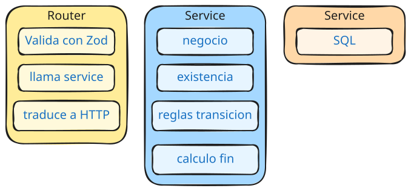
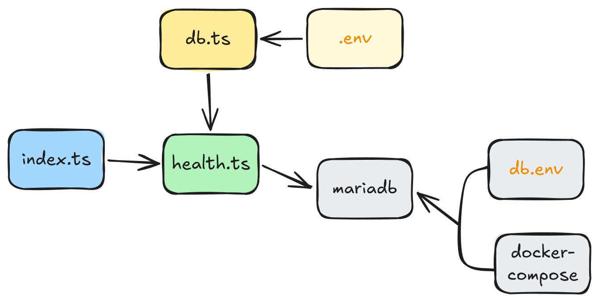
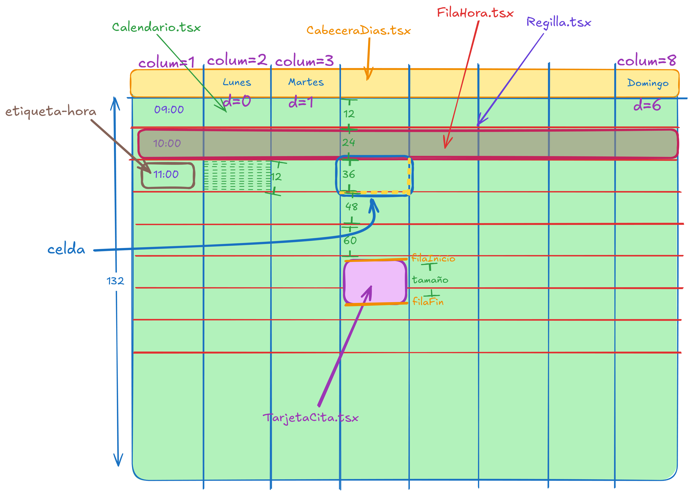

# Arquitectura — cómo está construido hoy (v4.1)

Lo que existe en el código. Lo que vendrá está en [dominio.md](dominio.md); el porqué de cada elección, en [decisiones.md](decisiones.md).

## Monorepo

```
compartido/ contratos de la API: esquemas Zod + tipos (npm workspace)
backend/    Express + TypeScript + Zod + mysql2
frontend/   React + Vite + TypeScript
infra/      MariaDB en Docker (docker-compose)
docs/       esta documentación (bóveda de Obsidian)
```



## Base de datos

MariaDB 12 en Docker, puerto `127.0.0.1:3305` (solo loopback). Docker solo crea la BD vacía y el usuario de la app; el esquema lo construyen las **migraciones** de `backend/migraciones/` (`npm run migrar`), y la tabla `migracion` recuerda cuáles se aplicaron. Los datos de ejemplo están en `backend/semillas/demo.sql` (`npm run sembrar`).

| Tabla | Columnas | Notas |
|---|---|---|
| `cliente` | id, nombre, telefono, email, notas | Todo opcional salvo el nombre. Teléfono como **texto** en E.164 (`+34612345678`). |
| `usuario`, `sesion` | quien entra en la app y sus sesiones | Rol (admin, encargado, recepción, empleado). La sesión guarda el SHA-256 del token. |
| `categoria_servicio` | id, nombre, activa | Editable; se desactiva, no se borra. |
| `empleado` | id, nombre, telefono, email, usuario_id, activo | Quien trabaja en el salón; enlace opcional a un usuario. |
| `contrato_empleado` | tipo, desde, hasta, tutor_id, empresa | Historial; el vigente no tiene `hasta`. |
| `competencia` | empleado_id, servicio_id, nivel | aprendiz / autonomo / experto. |
| `servicio` | id, nombre, categoria_id, duracion_min, precio, activo | Catálogo. Cambiarlo no altera citas ya creadas. |
| `cita` | id, cliente_id, servicio_id, inicio, fin, estado | FK a cliente y servicio. |

- `estado` es un ENUM `reservada` / `cancelada` / `completada`: **máquina de estados** y soft-delete (cancelar no borra).
- `inicio` y `fin` se **congelan en la cita** (snapshot): cambiar la duración del catálogo no altera las citas ya creadas.
- **No hay detección de solapes**: v1 asume una sola persona implícita.

## Backend

Capas: **router** (HTTP + Zod) → **service** (reglas de negocio) → **repository** (solo SQL parametrizado). Hoy solo `citas` tiene service; `clientes` y `servicios` son lecturas directas al repository.



| Método y ruta | Qué hace |
|---|---|
| `GET /health` | Comprueba de verdad la conexión a la BD. Fuera de `/api` a propósito. |
| `GET /api/servicios` | Listado. |
| `GET /api/clientes?buscar=` | Listado por nombre; `buscar` filtra por nombre, teléfono o email (`%` y `_` se buscan literalmente). |
| `GET /api/clientes/:id` | Un cliente o 404. |
| `POST /api/clientes`, `PATCH /api/clientes/:id` | Crear (201 `{ id }`) y editar (204). Mismo cuerpo, validado con `esquemaDatosCliente`. Los clientes no se borran. |
| `GET /api/citas` | Con JOIN que resuelve nombres de cliente y servicio. |
| `POST /api/citas` | Zod: `cliente_id`, `servicio_id`, `inicio` (ISO, en franja de 5 min). El `fin` lo calcula el backend. |
| `PATCH /api/citas/:id` | Mover: solo llega `inicio` (en franja de 5 min); el service recalcula el `fin`. |
| `POST /api/citas/:id/cancelar` | Transición a `cancelada`. |
| `POST /api/citas/:id/completar` | Transición a `completada`. |

- Mover, cancelar y completar solo desde `reservada`. Si no → **409**. Si no existe → **404**. Datos inválidos o JSON mal formado → **400**. Todos los errores responden `{ "error": "mensaje" }`.
- El pool de mysql2 usa `timezone: "Z"`: los `DATETIME` de la BD están en **UTC**.
- Errores tipados (`ErrorNoEncontrado`, `ErrorConflicto`) y middleware central, montado el último.

## Frontend

Calendario semanal en **CSS Grid escrito a mano**. Estilos con **CSS Modules**: cada componente tiene su `.module.css` al lado; solo `index.css` es global y define todas las variables (colores de la paleta ciruela, espacios, radio).



- Columnas: 1 de horas + **una por día visible**. Por defecto martes a sábado (`DIAS_APERTURA`); un lunes o domingo aparece si esa semana tiene citas, o con "Mostrar días cerrados" (`diasVisibles.ts`). Las columnas salen de la lista de fechas visibles: `columnaDeFecha` busca cada cita en ella.
- Filas: cabecera de 48px + 132 franjas de 5 min (9:00 a 20:00), **elásticas** (`minmax(4px, 1fr)`): la rejilla ocupa el alto de la ventana.
- Cada cita se coloca por columna (día) y filas (inicio → fin): **la altura del bloque es la duración**.
- Tarjetas con tinte y barra del color del estado (reservada ciruela, completada verde azulado con ✓, cancelada sin relleno, discontinua y tachada). Línea 1: cliente; línea 2: servicio y horario, que un *container query* oculta si no cabe. La seleccionada, con contorno.
- Cabecera: número de semana ISO en la esquina, "Mar 13" en cada día, y flechas circulares de semana flotando sobre los extremos.

| Archivo | Papel |
|---|---|
| `App.tsx`, `Marco.tsx` | Rutas con React Router (`/agenda`, `/clientes`, `/clientes/nuevo`, `/clientes/:id`) y barra de navegación. |
| `clientes/PaginaClientes.tsx` | Pantalla de clientes: dueña de la lista y la búsqueda (espera 300 ms; cada búsqueda cancela la anterior con `AbortController`); el cliente abierto sale de la URL. |
| `clientes/ListaClientes.tsx`, `FichaCliente.tsx`, `CampoTelefono.tsx` | Filas compactas con notas desplegables; formulario validado con el contrato; prefijo + número. |
| `sesion/`, `usuarios/` | Entrada, rutas protegidas, gestión de usuarios (admin) y mi cuenta. |
| `servicios/` | Catálogo agrupado por categoría y gestión de categorías (admin y encargado). |
| `empleados/` | Ficha del empleado (datos, historial de contratos, competencias) y cuadro empleados × servicios con avisos de huecos. |
| `Calendario.tsx` | Dueño del estado (`citas`, `clientes`, `servicios`, `lunesVisible`, `seleccion`) y de los fetch. |
| `calendario/CabeceraDias.tsx` | Semana ISO, días con su número y flechas de semana anterior / siguiente. |
| `calendario/Rejilla.tsx`, `FilaHora.tsx`, `CeldaHora.tsx` | Horas y celdas de una hora. Al pulsar, la franja de 5 min bajo el ratón (resaltada al pasar por encima); marcan la franja seleccionada. |
| `calendario/TarjetaCita.tsx` | Una cita en la rejilla. |
| `calendario/Panel.tsx` | Columna fija a la derecha: crear (cliente + servicio + fecha y hora), mover, cancelar, completar. Se cierra con la cruz roja. |
| `calendario/SelectorFechaHora.tsx`, `MiniCalendario.tsx` | Elegir fecha (mes con lunes primero, días de cierre atenuados) y hora (desplegables de 5 en 5), sin depender del idioma del navegador. |
| `calendario/diasVisibles.ts` | Qué días de la semana se pintan. |
| `calendario/fechas.ts`, `posicion.ts`, `constantes.ts` | Utilidades puras: semanas, semana ISO, fila y columna de una fecha, horario y días de apertura. |
| `tipos.ts` | Tipos del frontend, incluida la unión `Seleccion`. |
| `peticion.ts` | `pedir` / `pedirJson`: si la respuesta es un error, lanzan el mensaje del backend. |

- Solo se pintan las citas de la semana visible.
- Los botones de transición solo aparecen si `estado === "reservada"`.
- El `Panel` lleva `key` derivada de la selección para que el formulario nazca limpio al cambiar.
- BD y API en UTC; el navegador convierte a hora local solo para mostrar y para elegir fecha y hora.
- Si una petición falla, el aviso sale dentro del panel si está abierto (que no se cierra), o encima del calendario si no. Tras una acción fallida se refrescan igualmente las citas.

## Verificado en v1.0

- Ida y vuelta de zona horaria al mover: se guarda 10:00 y se relee 10:00.
- Las tres transiciones responden bien en los tres caminos (éxito / 409 / 404).
