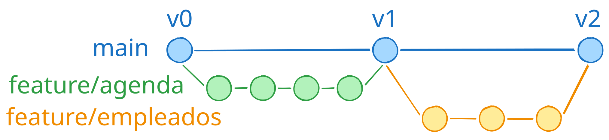

# Roadmap

Orden pensado para que cada paso se apoye en el anterior. **No se adelanta trabajo de una versión posterior**: si surge algo, se anota aquí y se sigue con lo actual. El detalle de lo que viene a partir de v4 está en [dominio.md](dominio.md).

## Hecho

- **v0** — Esqueleto del monorepo, Git, `.gitignore`, MariaDB en Docker.
- **v1.0** (22/08/2026, tag `v1.0.0`) — Agenda de una persona: crear, mover, cancelar y completar citas sobre un calendario semanal propio. Detalle en [arquitectura.md](arquitectura.md).
- **v1.1** (12/10/2026, tag `v1.1.0`) — CSS Modules: un `.module.css` por componente, sin cambios visuales. Primera versión implementada por Codex y revisada por Claude.
- **v1.2** (12/10/2026, tag `v1.2.0`) — Robustez: avisos de error del backend en la interfaz, fechas en UTC en la BD, inicio en franjas de 5 min, 400 en JSON mal formado, `precio` como texto, limpieza y script `typecheck`.
- **v1.3** (12/10/2026, tag `v1.3.0`) — Pulido estético: paleta ciruela en variables CSS, tarjetas con tinte y barra, calendario a todo el alto, panel a la derecha con selección visible, días de apertura (mar–sáb) con los de cierre bajo demanda, semana ISO y flechas en la cabecera. Resuelta la deuda del orden de la semana.
- **v1.4** (12/10/2026, tag `v1.4.0`) — Selector de fecha y hora propio (mini calendario del mes y desplegables de 5 en 5) para crear y mover; al pulsar un hueco, la cita empieza en la franja de 5 min bajo el ratón. Cierra la serie v1.
- **v2.0** (13/10/2026, tag `v2.0.0`) — Migraciones con script propio: `backend/migraciones/` como única fuente del esquema, `npm run migrar` y `npm run sembrar`; fuera `initdb/`.
- **v2.1** (13/10/2026, tag `v2.1.0`) — Tests con Vitest de la lógica pura: fechas, semana ISO, días visibles, posición, franjas, peticiones, archivos de migración y validación del inicio (59 tests). Pendiente: tests de integración con MariaDB, cuando haya migraciones que probar.
- **v2.2** (13/10/2026, tag `v2.2.0`) — Monorepo con npm workspaces y contratos de la API en `compartido/` (esquemas Zod), usados por backend y frontend; el frontend valida cada respuesta. Cierra v2.
- **v3.0** (13/10/2026, tag `v3.0.0`) — Clientes: navegación con React Router, pantalla lista + ficha con búsqueda, alta rápida desde la cita, email y notas (migraciones 001–002), teléfonos en E.164 con prefijo y formato (migración 003; absorbe la antigua v3.1). Cierra la serie v3.
- **v4.0** (14/10/2026, tag `v4.0.0`) — Usuarios y roles: sesión con cookie hecha a mano, cuatro roles (admin, encargado, recepción, empleado) con una sola tabla de permisos en `compartido/`, pantallas de entrada, usuarios y mi cuenta.
- **v4.1** (14/10/2026, tag `v4.1.0`) — Catálogo con categorías editables; empleados (separados de usuarios) con historial de contratos y competencias por nivel; cuadro empleados × servicios con avisos de huecos.
- **v4.2** (14/10/2026, tag `v4.2.0`) — Duraciones y márgenes por empleado y servicio (margen del servicio + del empleado), dificultad del servicio con aviso para aprendices, historial de cambios; solo admin y encargado.

## Cómo se numera

- **vX.Y** es una **subversión**: un paso con sentido propio, que se prueba y se cierra con su tag `vX.Y.0`.
- **vX.Y.Z** es un **arreglo o ajuste** dentro de una subversión ya cerrada (p. ej. `v4.4.1`), con su propio tag.
- Las subversiones de las versiones futuras son una previsión: se afinan al llegar a cada una.

## Siguiente — lo que queda de v4 (plantilla, tiempos y local)

| Subversión | Contenido |
|---|---|
| **v4.4.1** | Horario y Recursos en dos pantallas separadas, a pantalla completa. |
| **v4.5** | **Turnos**: qué días y horas trabaja cada empleado (varios tramos por día, como el horario del local). |
| **v4.6** | **Ausencias**: vacaciones, bajas, formación… por rangos de fechas. |
| **v4.7** | **Bloqueos por eventos** (bodas…): una franja que inutiliza empleados y/o recursos concretos, con motivo. Avisa de las citas que chocan; no las borra. |
| **v4.8** | **Plano del local**: salón, recepción, lavado, almacén, caja, zona de tintes y herramientas…, con los recursos colocados. Editor sobre rejilla. La ocupación (qué zona usa cada empleado con su cliente, y su limpieza antes del siguiente) llega en v6.6, cuando las citas tengan empleado y recurso. |
| **v4.9** | **Incidencias de clientes**: el encargado anota situaciones problemáticas con un cliente; solo las ven encargado y admin. |

## Después (previsión por subversiones)

### v5 — Mejoras sueltas
| | |
|---|---|
| v5.0 | Mostrar la agenda en la **hora del salón** aunque el dispositivo esté en otra zona (hoy solo avisa). |
| v5.1 | **Aligerar el paquete** del frontend (pasa de 500 KB, sobre todo por libphonenumber-js): pantallas bajo demanda o metadatos reducidos. |
| v5.2 | Cargar las citas **por rango de fechas** desde el backend (hoy se traen todas). |
| v5.3 | **Modo oscuro** sobre las variables de `index.css`. |
| v5.4 | Vista para **móvil**. |

### v6 — Agenda real y motor de asignación (§6–7 de [dominio.md](dominio.md))
| | |
|---|---|
| v6.0 | Cita como **cabecera + líneas** (`cita_servicio`), con migración no destructiva de las citas actuales. |
| v6.1 | **Empleado(s) y recurso** en cada línea (participantes: principal, ayudante, tutor); estados `no_asistio` y `solicitada`. El panel de la cita muestra los empleados asignados. |
| v6.2 | **Solapes y disponibilidad**: empleado y recurso libres, horario del local, turnos, ausencias y bloqueos. Guardado que revalida en una transacción. |
| v6.3 | **Fases** de un servicio (activa, pasiva, revisión), cada una con su recurso. |
| v6.4 | **Motor**: sugiere empleado + recurso + hora, con el motivo; no propone aprendices para servicios difíciles. |
| v6.5 | **Inicio y fin reales** de cada línea y **sugerencias de duración** (mediana de casos parecidos) que el encargado acepta o no. |
| v6.6 | **Ocupación en el plano**: qué zona usa cada empleado con su cliente y su limpieza antes del siguiente. |
| v6.7 | **Arrastrar citas** (ver abajo). |

### v7 — Dinero y stock (§8)
| | |
|---|---|
| v7.0 | Tickets y cobros (efectivo, tarjeta, Bizum), con el precio congelado. |
| v7.1 | Caja diaria: apertura, cierre y arqueo. |
| v7.2 | Comisiones y reparto con externos. |
| v7.3 | Proveedores (la empresa de los externos pasa de texto a ficha). |
| v7.4 | Productos y movimientos de stock (venta, consumo en servicios, compras). |
| v7.5 | Combos o packs promocionales. |
| v7.6 | VERI\*FACTU, antes de cobrar de verdad a clientes reales. |

### v8 — Gestoría y papeleo ⚠️ *relevante para el usuario* (§12)
| | |
|---|---|
| v8.0 | Datos personales del empleado (DNI, dirección, n.º de la Seguridad Social, cuenta), con acceso restringido y RGPD. |
| v8.1 | Documentos por empleado (contrato firmado, certificados). |
| v8.2 | Altas y bajas en la Seguridad Social a partir del historial de contratos. |
| v8.3 | Exportaciones mensuales para la gestoría (horas, ausencias, comisiones, facturas) y rol **gestoría** de solo lectura. |
| v8.4 | Facturas recibidas y gastos. |

### v9 — Asistentes (§10)
| | |
|---|---|
| v9.0 | API para asistentes sobre el motor de v6; las citas que crean quedan `solicitada` hasta que una persona las confirma. |
| v9.1 | Telegram. |
| v9.2 | WhatsApp. |
| v9.3 | Llamadas. |

### Más allá
Estadísticas para el encargado: **productividad y trato de cada empleado** (tiempo real frente a estimado, servicios por día, valoraciones), cancelaciones y no presentados por cliente, ocupación. Zona de espera y cola.

### Despliegue
Aparcado: el Windows de bot_trading va justo. Cuando toque, en una máquina virtual del portátil o en otro ordenador, con Docker Compose. **Dos servicios independientes**: frontend estático (el build ya incluye `compartido/`) servido por Nginx, que reenvía `/api` al contenedor del backend. Decidir entonces si el backend corre con `tsx` o se empaqueta en un solo JS. Nginx debe devolver `index.html` para cualquier ruta del frontend (`try_files`), porque las URLs de React Router (`/clientes/12`) no son archivos. Al cambiar un contrato: añadir campos es seguro; quitar o renombrar exige desplegar primero el backend aceptando ambos.

### Arrastrar citas (v6.7)

- Librería recomendada: **dnd-kit** (ya usada en bot_trading); se confirma al llegar. Ver [dominio.md](dominio.md) → "Librerías".
- Reintroduce la variante `{ tipo: "moviendo"; id }` en `Seleccion` (descartada en v1 porque el `datetime-local` la hacía innecesaria).
- Auto-avance de semana al llevar la cita al borde: temporizador que dispara `±7 días` mientras el puntero está en la franja lateral y se cancela al volver; `useEffect` con limpieza.
- Casos borde: soltar fuera de celda válida, sobre otra cita, fuera de horario, durante el cambio de semana; eventos táctiles.
- Va después del motor porque necesita saber si el hueco de destino es válido.
- Que se vea la **animación** de la tarjeta viajando de un día a otro (en dnd-kit, `DragOverlay`).
- Revisar entonces el panel: pasar de columna a la derecha a **una tarjeta que se amplía** (zoom sobre la propia cita) **o una ventana flotante**. Encaja mejor con arrastrar, porque la acción ocurre sobre la cita y no en una columna aparte.

### Ramas

Hasta v1 todo se hizo en `main` con tags. Para v2 en adelante hay prevista una rama por frente (`feature/agenda`, `feature/empleados`…):

## Decisiones abiertas

Se deciden de una en una, cuando toque.

| Decisión | Cuándo |
|---|---|
| Dónde y cómo desplegar (máquina virtual del portátil u otro ordenador; si se usa `dev.artesaniaartur.es`, por ruta o por subdominio) | Despliegue |
| ¿El cliente puede elegir empleado o solo expresar preferencia? | v6.1 |
| ¿Alguien en prácticas puede hacer algún servicio sin tutor? | v6.1 |
| Arrastrar citas: confirmar dnd-kit | v6.7 |
| Plano: SVG a mano + dnd-kit, o React Flow | v4.8 |
